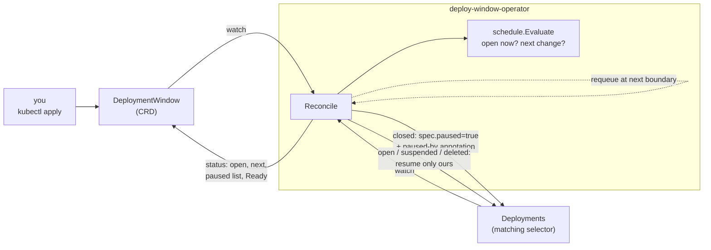

# deploy-window-operator

A Kubernetes operator that only lets selected Deployments roll out during allowed time windows, for example weekdays 09:00–17:00 Lagos time. Outside the window it pauses them (`spec.paused: true`), so a new image or config change waits until the window opens. Built with Kubebuilder and controller-runtime.

## Why

Many teams have a rule like "no production deploys on Friday evening or at the weekend". Usually that rule lives in a wiki page. This operator enforces it in the cluster, whatever tool (kubectl, Argo CD, a CI job) changes the Deployment.

## How it works

```yaml
apiVersion: policy.deploywindow.dev/v1alpha1
kind: DeploymentWindow
metadata:
  name: business-hours
  namespace: default
spec:
  selector:
    matchLabels:
      tier: prod
  timeZone: Africa/Lagos
  windows:
    - days: [Mon, Tue, Wed, Thu, Fri]
      start: "09:00"
      end: "17:00"
  suspend: false        # true = emergency fix: release everything
```

```
$ kubectl get dw
NAME             OPEN    MATCHED   NEXT                   SUSPENDED
business-hours   false   3         2026-11-17T08:00:00Z   false
```



The reconcile loop:
1. Work out whether the window is open now and when that next changes (`internal/schedule`, a pure function with no Kubernetes code).
2. List Deployments in the namespace and match them against the selector.
3. **Closed:** pause each matching Deployment and mark it with the annotation `deploywindow.dev/paused-by: <window>`.
4. **Open, suspended, or the Deployment no longer matches:** resume only the Deployments **this window** paused. A Deployment someone paused by hand has no annotation, so it is left alone.
5. Write the status: `open`, `nextTransition`, `matchedDeployments`, `pausedDeployments` and a `Ready` condition.
6. Requeue for exactly the next boundary, so nothing polls.

Other behaviour:
- **Watches Deployments too.** A new or relabelled Deployment is handled at once, not at the next boundary.
- **Finalizer.** Deleting a window resumes everything it paused before the object is removed.
- **Invalid spec** (an unknown time zone, or an end before the start): `Ready=False` with reason `InvalidSpec`, and nothing stays paused.
- Windows don't cross midnight. For 22:00–02:00, use two windows.

## Demo

`hack/demo.sh` runs the full story on a real cluster. Output from a kind run is in [`docs/demo-output.txt`](docs/demo-output.txt):

1. A closed window pauses the `tier=prod` Deployment.
2. Changing its image creates **no new ReplicaSet**: the rollout waits.
3. `suspend: true` resumes it and the rollout completes.
4. `suspend: false` pauses it again.
5. Deleting the window resumes it (finalizer).

## Tests

```bash
make test
```

- `internal/schedule`: table tests for open/closed checks, time zones, back-to-back windows, the weekend wait, and invalid input (93% coverage).
- `internal/controller`: envtest tests against a real API server with a fake clock. They cover pausing, resuming only what the window paused, time zones, suspend, a Deployment leaving the selector, deletion and invalid specs (77% coverage).

## Run it

```bash
kind create cluster
make install                 # install the CRD
make run                     # run the controller locally
kubectl apply -f config/samples/policy_v1alpha1_deploymentwindow.yaml
hack/demo.sh                 # optional end-to-end demo
```

To deploy in-cluster: `make docker-build docker-push IMG=<registry>/deploy-window-operator:<tag>` then `make deploy IMG=...`.

## Limits

- Pausing stops **new** rollouts. A rollout already in progress when the window closes stops where it is and finishes when the window opens.
- Deployments only, not StatefulSets or DaemonSets (they have no `paused` field).
- One namespace per window.

## License

Apache 2.0
