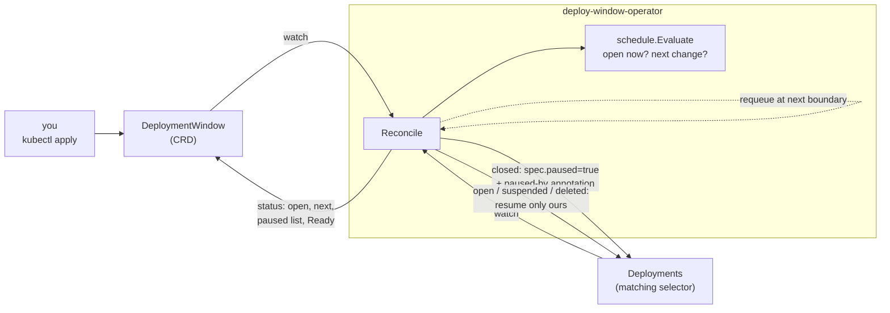

# deploy-window-operator

A Kubernetes operator that only lets selected Deployments roll out during allowed time windows, for example weekdays 09:00–17:00 Lagos time. Outside the window it sets `spec.paused: true` on them, so a new image or config change waits until the window opens. Built with Kubebuilder (v4) and controller-runtime.

**Why:** many teams have a rule like "no production deploys on Friday evening or at the weekend", but the rule lives in a wiki. This operator enforces it inside the cluster, whichever tool (kubectl, Argo CD, a CI job) changes the Deployment.

## Architecture



## API

`policy.deploywindow.dev/v1alpha1`, kind `DeploymentWindow` (short name `dw`), namespaced.

```yaml
apiVersion: policy.deploywindow.dev/v1alpha1
kind: DeploymentWindow
metadata:
  name: business-hours
  namespace: default
spec:
  selector:
    matchLabels:
      tier: prod
  timeZone: Africa/Lagos
  windows:
    - days: [Mon, Tue, Wed, Thu, Fri]
      start: "09:00"
      end: "17:00"
  suspend: false        # true = emergency fix: release everything
```

| Spec field | Type | Meaning | Validation |
|---|---|---|---|
| `selector` | LabelSelector | Deployments in the same namespace to control | required |
| `timeZone` | string | IANA zone used for `start` and `end` | default `UTC`; an unknown zone sets `Ready=False` |
| `windows[].days` | []string | Days the window applies to | enum `Mon`…`Sun`, at least 1 |
| `windows[].start`, `end` | string | `HH:MM`, 24-hour, end after start | regex in the CRD; end ≤ start sets `Ready=False` |
| `suspend` | bool | Stop enforcing and resume what this window paused | optional |

| Status field | Meaning |
|---|---|
| `open` | Rollouts are allowed right now |
| `nextTransition` | When `open` next changes |
| `matchedDeployments` | How many Deployments the selector matches |
| `pausedDeployments` | Names this window has paused |
| `conditions[type=Ready]` | `True/Applied`, or `False/InvalidSpec` with the error |
| `observedGeneration` | Spec generation the status reflects |

```
$ kubectl get dw
NAME             OPEN    MATCHED   NEXT                   SUSPENDED
business-hours   false   3         2026-11-17T08:00:00Z   false
```

## Reconcile loop

1. **Finalizer:** add `deploywindow.dev/resume-on-delete` if missing. If the object is being deleted, resume everything it paused, remove the finalizer and stop.
2. **Schedule:** `schedule.Evaluate(now, timeZone, windows)` returns whether the window is open and the next boundary where that flips. If the spec is invalid, resume everything this window paused, set `Ready=False` and stop.
3. **List** Deployments in the namespace and test each against the selector.
4. **Act** on each Deployment:

   | Window state | Deployment | Action |
   |---|---|---|
   | Closed, not suspended | matches, not paused | Pause it and add `deploywindow.dev/paused-by: <window>` |
   | Closed, not suspended | matches, already paused by us | Nothing |
   | Closed, not suspended | matches, paused by someone else (no annotation) | Nothing; never claimed |
   | Open, or suspended | paused by us | Resume it and remove the annotation |
   | Any | paused by us but no longer matches | Resume it |

5. **Status:** write the status fields and the `Ready` condition.
6. **Requeue** for `nextTransition − now + 1s`, so the controller wakes up exactly at the next boundary instead of polling.

The controller also **watches Deployments** and maps each event to every `DeploymentWindow` in that namespace. A new or relabelled Deployment is handled immediately, not at the next boundary.

## Design decisions

| Decision | Why |
|---|---|
| Use `spec.paused`, not an admission webhook | The Deployment controller already stops creating new ReplicaSets while paused, so a pending change simply waits. No webhook, no TLS certificates, and no risk of blocking the API server. |
| Ownership annotation `paused-by` | The operator only resumes Deployments it paused. A pause a person made by hand is never undone. |
| Finalizer | Deleting a window must not leave Deployments paused forever. |
| Requeue at the next boundary | No polling loop. One reconcile per window change, plus one per Deployment event. |
| Schedule as a pure function (`internal/schedule`) | All the date and time-zone logic is tested without Kubernetes. The reconciler takes an injectable clock (`Now func() time.Time`), so tests can pick any moment. |
| Fail open on an invalid spec | A typo in the time zone releases the Deployments and reports `InvalidSpec`, instead of freezing production. |
| Status written with `Update`, not a merge patch | A merge patch built from a copy drops fields whose value did not change, so `open: false` was never stored. The end-to-end demo found this; `Update` writes the whole status. |

**RBAC** (generated `ClusterRole` from the `+kubebuilder:rbac` markers): full access to `deploymentwindows`, plus `deploymentwindows/status` and `deploymentwindows/finalizers`; `get, list, watch, update, patch` on `deployments`. No other resources.

## Demo

`hack/demo.sh` runs the full story against the current cluster. Output from a kind run is in [`docs/demo-output.txt`](docs/demo-output.txt):

1. A closed window pauses the `tier=prod` Deployment.
2. Changing its image creates **no new ReplicaSet**: the rollout waits.
3. `suspend: true` resumes it, and the rollout completes.
4. `suspend: false` pauses it again.
5. Deleting the window resumes it (finalizer).

## Tests

```bash
make test        # unit + envtest
make lint        # golangci-lint
```

- **`internal/schedule`** (93% coverage), table tests for:
  - open and closed times, including the exact start and end
  - time zones
  - back-to-back windows and gaps between windows
  - the Friday-to-Monday wait
  - invalid input
- **`internal/controller`** (77% coverage): envtest runs a real API server and etcd, with a fake clock. Seven scenarios:
  - pause outside the window, and leave other Deployments alone
  - resume only what this window paused, keeping a manual pause
  - time zones
  - suspend
  - a Deployment leaving the selector
  - deletion through the finalizer
  - an invalid time zone
- **CI:** GitHub Actions runs lint, tests and the Kubebuilder e2e workflow (`.github/workflows`).

## Run it

```bash
kind create cluster
make install                 # install the CRD
make run                     # run the controller locally against the current context
kubectl apply -f config/samples/policy_v1alpha1_deploymentwindow.yaml
hack/demo.sh                 # optional end-to-end demo
```

To deploy in-cluster: `make docker-build docker-push IMG=<registry>/deploy-window-operator:<tag>`, then `make deploy IMG=...`.

## Layout

```
api/v1alpha1/          DeploymentWindow types and kubebuilder markers (CRD schema, validation, print columns)
internal/schedule/     pure window logic: Evaluate(now, tz, windows) -> open, next
internal/controller/   reconciler, Deployment watch, envtest suite
config/                generated CRD, RBAC, manager, samples (kustomize)
hack/demo.sh           end-to-end demo; output in docs/demo-output.txt
```

## Limits

- Pausing stops **new** rollouts. A rollout already in progress when the window closes stops where it is and finishes when the window opens.
- Deployments only. StatefulSets and DaemonSets have no `paused` field.
- A window controls Deployments in its own namespace only.
- Windows don't cross midnight. For 22:00–02:00, use two windows.

## License

Apache 2.0
